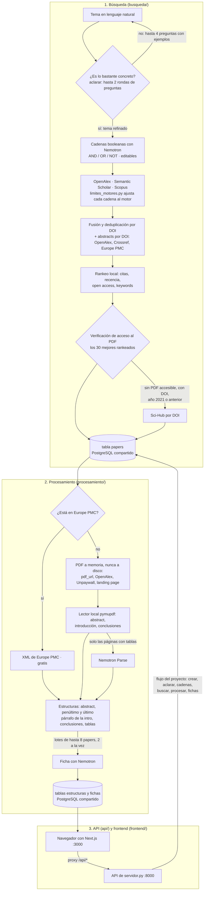
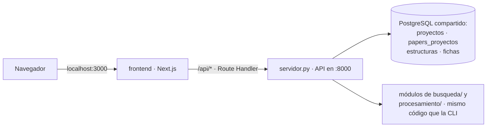

# Research Automator

Research Automator es una herramienta de IA (LLM + RAG) para revisiones de literatura científica. A partir de un tema en lenguaje natural genera cadenas de búsqueda booleanas, las ejecuta en varias plataformas académicas, rankea y deduplica los papers, descarga su texto completo y extrae hallazgos estructurados con un LLM.

El proyecto está estructurado en tres módulos independientes que se combinan en el frontend:

- **Búsqueda** (`busqueda/`) — recolección de papers.
- **Procesamiento** (`procesamiento/`) — extracción y análisis con LLM.
- **API** (`api/`) y **Frontend** (`frontend/`) — la API combina los dos anteriores y la interfaz web la consume.

---

## Flujo general



Todo se guarda en una única base **PostgreSQL** (variables `NEON_*` en `.env`; el plan gratuito de [Neon](https://neon.tech) sirve, y el esquema se crea solo en la primera conexión — ver `busqueda/database.py`):

- `papers`: metadatos y abstract de cada paper, una sola fila por paper aunque varios proyectos lo compartan (dedup real por `paper_id`).
- `proyectos` + `papers_proyectos`: cada proyecto del navegador es una fila, con su estado completo en JSONB, y su relación con los papers (orden del ranking, score, selección). La parte "no relacional" (documentos variables consultables con `->>`, `@>`) vive en columnas JSONB con índices GIN.
- `estructuras` y `fichas`: las piezas leídas de cada paper y el resumen de Nemotron, con el payload en JSONB.

Hay dos formas de recorrer este flujo:

1. **Por línea de comandos**, módulo por módulo, guardando papers en la base sin proyecto asociado (ver `COMANDOS.md`).
2. **Por la web** (`api/servidor.py` + `frontend/`): cada proyecto que creas en el navegador vive en sus filas de `proyectos`/`papers_proyectos` y ahí mismo puedes correr "Procesar PDFs" sin tocar la terminal.

---

## Instalación

```bash
python3 -m venv venv
source venv/bin/activate
pip install -r requirements.txt       # todo el proyecto
# o, si solo quieres la búsqueda (sin Nemotron Parse ni PyMuPDF):
pip install -r busqueda/requirements.txt
```

Copia `.env.example` a `.env` en la raíz y completa las keys que necesites (detalle de cada una más abajo). Las únicas obligatorias para que el proyecto corra son las de la base PostgreSQL, una por dato (`NEON_HOST`, `NEON_DATABASE`, `NEON_USER`, `NEON_PASSWORD`, `NEON_SSL_MODE`; Neon, Supabase o un Postgres propio): el esquema se crea solo en la primera conexión. Con la base lista, verifica con `python probar_postgres.py` desde la raíz.

---

## 1. Búsqueda (`busqueda/`)

Automatiza la generación de cadenas de búsqueda y la recolección de papers.

- **Generación de cadenas**: un LLM convierte el tema en lenguaje natural en cadenas booleanas (`AND`/`OR`/`NOT`), editables antes de lanzar la búsqueda (`generar_cadenas.py`). Usa Nemotron (NVIDIA), al que se le piden solo los términos de cada grupo y el código arma la sintaxis (comillas, `OR`, `AND`, `NOT`), porque escribiendo la cadena completa ignoraba los operadores; en español/«Ambos» un segundo paso corto restaura las tildes; si no responde, la interfaz arma cadenas básicas con las palabras del tema. El tema se puede escribir en español; las cadenas salen por defecto en inglés, porque casi toda la literatura indexada está en ese idioma (la misma cadena en español encuentra del orden de 50 veces menos papers).
- **Papers científicos**: busca en [OpenAlex](https://openalex.org), [Semantic Scholar](https://www.semanticscholar.org) y Scopus (motor por motor, para mostrar avance y abortar pronto), hasta `MAX_RESULTS_PER_QUERY` (25) resultados por cadena y motor; fusiona los resultados y deduplica por DOI. Todos los DOI pasan por `busqueda/doi.py`, que los deja en un formato único (`https://doi.org/` + DOI en minúsculas): los DOI no distinguen mayúsculas y cada motor los entregaba distinto, así que el mismo paper entraba dos veces (`10.1109/ICETAS…` y `10.1109/icetas…`). Ese formato es también el `paper_id` de los papers con DOI.
- **Abstracts**: Scopus no entrega el abstract y a veces OpenAlex o Semantic Scholar tampoco; `completar_abstracts.py` lo pide por DOI a OpenAlex, Crossref y Europe PMC (gratis, sin key) antes de rankear, porque sin abstract el paper puntúa peor.
- **Rankeo local** (`rank_and_filter.py`, compartido por la CLI y el frontend): puntúa citas (escala logarítmica), recencia, acceso abierto y coincidencias de las keywords de la propia cadena en título y abstract. Define el orden de la tabla y qué papers entran a la verificación de PDF.
- **Semantic Scholar re-rankeado en local**: su búsqueda que entiende operadores booleanos (bulk) solo ordena por citas, y los más citados del área se desviaban del tema. `fetch_semantic_scholar.py` trae un pool de hasta 100 resultados y devuelve los mejor puntuados por las keywords de la propia cadena (`rank_and_filter`), al mismo costo en solicitudes (medido en `pruebas/cadenas/sonda_s2_v2.py`: 12/26 de estricta/laxa del top por citas contra 15/30 del re-rankeado, con pool lleno).
- **Ejecución en OpenAlex** (medida con el banco de pruebas `pruebas/cadenas/amplitud.py`, 8 temas y juez LLM sobre los títulos): al traducir la cadena se ignoran las comillas de las frases exactas (encuentra de un 15 % a nueve veces más papers con la misma precisión) y si la búsqueda en título y abstract trae menos de `UMBRAL_RESCATE_FULLTEXT` (15, constante en `fetch_papers.py`) se aplican dos rescates que se fusionan: primero cada par de grupos AND (la variante de mejor precisión medida) y después el texto completo (`default.search`). Con `OPENALEX_API_KEY` en `.env` (gratis) se evita el 429 del presupuesto diario compartido por IP; sin key se usa el "polite pool" vía `mailto`.
- **Acceso a texto completo**: integra [Sci-Hub](https://sci-hub.ru) (opcional, `USAR_SCIHUB` en `config.py`) para resolver PDFs por DOI cuando las plataformas tienen el archivo bloqueado.
- **Autonomía**: todo se guarda en la base PostgreSQL. Corriendo por línea de comandos no necesita ningún LLM salvo para generar las cadenas (eso solo pasa en el frontend).

```bash
cd busqueda
python main.py
```

Configuración en `busqueda/config.py` (`PAPER_QUERIES`, años mínimos, `USAR_SCIHUB`, etc.).

---

## 2. Procesamiento (`procesamiento/`)

Toma los papers de la búsqueda y arma una *ficha* de cada uno leyendo solo las piezas que importan. Ya no se extraen variables sueltas (temperatura, pH...): sin el contexto del paper no eran utilizables.

### 2.1 Estructura del paper
`lectura_pdf.py` obtiene cinco piezas: el **abstract**, el **penúltimo y el último párrafo de la introducción** (el problema y el objetivo), las **conclusiones** y las **tablas** (nombre y atributos = encabezados de columna). Si el paper está en Europe PMC se lee su XML gratis; si no, se descarga su PDF **a memoria** (nunca se guarda en disco) probando en orden el enlace ya registrado (`pdf_url`), las ubicaciones abiertas de OpenAlex, Unpaywall (por DOI) y la propia página del paper (etiqueta `citation_pdf_url`), y se lee en dos tiempos: primero en local y gratis con `pymupdf` (abstract, introducción y conclusiones salen del texto, y se anota en qué páginas están los títulos `Table N`), y después solo esas páginas, hasta `MAX_PAGINAS_TABLAS_PARSE`, van a Nemotron Parse (NVIDIA; lee cada página como imagen y tarda decenas de segundos por página, por eso las páginas se leen en paralelo) para leer bien las tablas. Un PDF con un formato que el lector local no entiende se envía parcialmente, pero con las páginas exactas que `pymupdf` ubicó: las primeras `PAGINAS_INICIALES_PARSE`, las de las conclusiones y las de los títulos de tabla. Solo un PDF escaneado (sin texto, imposible de ubicar) usa las primeras y las últimas, hasta `MAX_PAGINAS_PARSE`. Solo se guarda en la tabla `estructuras` el texto de las piezas, no el PDF, y así no se vuelve a leer.

Se leen los papers de acceso abierto y los que Sci-Hub resolvió por DOI (que traen `pdf_url`). Sci-Hub solo se consulta para papers de 2021 o anteriores (`SCIHUB_ULTIMO_ANIO` en `busqueda/config.py`): después de esa fecha dejó de agregar papers.

### 2.2 Ficha con Nemotron
`extract_ficha.py` envía esas piezas (varios papers por solicitud) a Nemotron (NVIDIA; `HILOS_LOTES_FICHA` lotes a la vez) y guarda en `fichas`: una frase de síntesis (`en_una_frase`), la **relevancia para el tema refinado del proyecto** (alta, media, baja o nula) con su motivo, qué aporta concretamente al tema, objetivo, método (tipo de estudio, muestra o datos, contexto), hasta 4 hallazgos clave, hasta 3 conclusiones, las limitaciones que declaran los autores y qué aporta cada tabla. Un paper sin PDF accesible recibe una ficha **parcial** (solo el abstract). Los de relevancia «nula» quedan con estado `no_relevante`. Las fichas anteriores a este esquema se siguen mostrando (como relevancia «media» o «nula») y se regeneran solas al volver a procesar, porque cambió la versión del prompt. Es incremental: si las piezas y el prompt no cambiaron, no se vuelve a llamar al modelo. La interfaz muestra además las piezas tal como salen del paper (abstract, párrafos de la introducción y conclusiones), sin pasar por el modelo.

Necesita `NVIDIA_API_KEY` y `NVIDIA_PARSE_API_KEY` en `.env`; el modelo y las URL van en `busqueda/config.py` (no son secretos).

```bash
cd procesamiento
python probar_nvidia.py                # prueba de conexión con Nemotron y Nemotron Parse
python lectura_pdf.py paper.pdf  # estructura de un PDF local
python extract_ficha.py --top 20 --tema "..."  # fichas de los mejores papers del ranking
python extract_ficha.py --forzar       # vuelve a leer y a generar aunque ya existan
```

---

## 3. API (`api/`) y frontend (`frontend/`)

Interfaz web que combina Búsqueda y Procesamiento. Cada proyecto de investigación:

1. Se describe en lenguaje natural → genera cadenas de búsqueda editables.
2. Lanza la búsqueda → resultados rankeados, con selección manual de papers.
3. Los resultados tienen dos pestañas. **Resultados de búsqueda** es la tabla de papers (filtros, selección, exportar CSV). **Resultados de procesamiento** es donde se lanza "Procesar PDFs": se procesan **solo los papers seleccionados** en Resultados de búsqueda (sin selección, la API responde 400 y la interfaz pide marcar papers), con un tope por corrida editable, entre 1 y `MAX_PAPERS_PROCESAR_WEB` (100) en `config_proc.py` —el techo lo fija el servidor—, y corre `extract_ficha.py` (Nemotron Parse + Nemotron) sobre los papers de ese proyecto en la base compartida (tablas `estructuras` y `fichas`).
4. Mientras corre, esa pestaña muestra el avance por paper y el log; al terminar, el resumen (fichas, papers con PDF leído, solo abstract, estado por paper) y las fichas ordenadas por relevancia. Cerrada, cada ficha muestra solo el título, la relevancia con su motivo y una frase; abierta, el detalle se reparte en tres solapas: «Lo esencial» (qué aporta al tema, objetivo, hallazgos), «Método y conclusiones» (método, conclusiones, limitaciones y tablas plegadas) y «Texto original» (abstract, final de la introducción y conclusiones tal como salen del paper). Tiene búsqueda, filtros por relevancia (útiles, solo alta, tangenciales, no relevantes, todas) y exportación a CSV. Si la corrida falla o se cancela, lo ya procesado queda como resultado parcial y se puede reintentar (los papers con ficha no se vuelven a leer ni a enviar al modelo).

**Aclaración del tema.** Al pulsar «Generar cadenas», Nemotron evalúa si el prompt es lo bastante concreto (objeto de estudio, qué se quiere saber, contexto). Si no, hace hasta 4 preguntas (máximo 2 rondas, con ejemplos de respuesta) en la misma pestaña; con las respuestas reescribe el tema y a partir de ahí genera las cadenas. Se puede omitir. El tema refinado también se usa para marcar papers no relevantes.

**Límites de cada motor.** `busqueda/limites_motores.py` ajusta cada cadena al motor antes de enviarla, sin intervención: OpenAlex (URL de ~4 KB, hasta 100 alternativas por filtro), Scopus (máximo recomendado de 50 operadores booleanos) y Semantic Scholar (sin tope publicado; se usa un tope prudente de URL). Si no cabe, se quitan primero las últimas alternativas OR del grupo más largo y se avisa en la consola; la cadena guardada en el proyecto no se modifica.

**Dos partes.** `api/servidor.py` es el backend (la API en `/api/proyectos…`, en Python con la librería estándar). La interfaz nueva vive en `frontend/`, un proyecto **Next.js** (App Router, React, TypeScript) con su propio `package.json`. La interfaz anterior (HTML y JS sin framework, estilo Nocturne) se eliminó el 2026-11-04.

**Comunicación.** El navegador solo habla con Next. Un Route Handler (`frontend/src/app/api/[...ruta]/route.ts`) reenvía `/api/*` al backend, cuya dirección sale de `API_URL` (por defecto `http://127.0.0.1:8000`); así no hace falta CORS y el backend no cambia. El avance de la búsqueda y del procesamiento se consulta cada 1 s mientras hay algo en curso.



**Estructura de `frontend/src/`.**

- `app/` — layout, página única y el proxy de la API. `organic.css` es el sistema de diseño Organic (tokens y componentes base) y `globals.css` las utilidades compartidas.
- `lib/` — `tipos.ts` (contrato de la API), `api.ts` (cliente tipado) y `formato.ts` (funciones puras).
- `hooks/` — `useProyectos` (lista, proyecto activo, fichas y sondeo) y `useAclaracion` (rondas de preguntas).
- `context/AppContext.tsx` — une los hooks y expone las acciones del flujo, los diálogos de confirmación y los avisos.
- `components/` — `layout/` (barra lateral, encabezado, avisos), `vistas/` (prompt, aclaración, cadenas, búsqueda en curso, resultados), `resultados/` (tabla, panel de paper, procesamiento y fichas) y `ui/` (diálogo y toast). Cada componente trae su archivo `.module.css`.

**Diseño.** Viene de Claude Design (sistema Organic: fondo crema, acento terracota, Caprasimo y Figtree). Se conservan las rutas de la API y el flujo anterior; el tope «Máx. papers por corrida» se puede bajar desde la tarjeta (el techo lo fija el servidor).

```bash
# Backend (desde la raíz, con el venv activo)
cd api
python servidor.py        # API en http://127.0.0.1:8000
python servidor.py 8080   # en otro puerto

# Interfaz Next.js (en otra terminal)
cd frontend
npm install               # solo la primera vez
npm run dev               # http://localhost:3000
```

El backend no agrega dependencias propias: reutiliza los módulos de `busqueda/` y `procesamiento/` (ver `api/servidor.py`, que agrega ambas carpetas a `sys.path` al arrancar). Las dependencias de la interfaz (`next`, `react`, `react-dom`, `lucide-react`, `typescript`) viven solo en `frontend/package.json`.

---

## Variables de entorno (`.env` en la raíz)

| Variable | Para qué | Dónde se usa |
|---|---|---|
| `NEON_HOST`, `NEON_DATABASE`, `NEON_USER`, `NEON_PASSWORD`, `NEON_SSL_MODE` | Datos de conexión de la base PostgreSQL donde se guarda todo (obligatorios; el plan gratuito de Neon sirve). `config.py` arma la URL | `busqueda/database.py` |
| `OPENALEX_API_KEY` | Opcional: cuota propia en OpenAlex (sin ella, el presupuesto diario se comparte por IP y se agota con 429) | `busqueda/fetch_papers.py` |
| `SEMANTIC_SCHOLAR_API_KEY` | Búsqueda en Semantic Scholar | `busqueda/fetch_semantic_scholar.py` |
| `SCOPUS_API_KEY` / `SCIENCEDIRECT_API_KEY` | Búsqueda en Scopus | `busqueda/fetch_scopus.py` |
| `NVIDIA_API_KEY` | Nemotron: aclara el tema, genera las cadenas y arma las fichas | `busqueda/generar_cadenas.py`, `procesamiento/extract_ficha.py` |
| `NVIDIA_PARSE_API_KEY` | Nemotron Parse: lee las tablas y los PDFs que el lector local no entiende | `procesamiento/lectura_pdf.py` |

Lo **no secreto** no va en `.env`: el modelo de NVIDIA y las URL están en `busqueda/config.py` (los comparten búsqueda y procesamiento), y los parámetros del procesamiento en `procesamiento/config_proc.py`. El email de contacto ante las APIs académicas (`mailto` de OpenAlex) también: está fijado en `CONTACT_EMAIL` en `busqueda/config.py`.

---

## Alcance y próximos pasos

Flujo del producto: **aclarar el tema → generar cadenas → (el usuario las revisa) → buscar y mostrar lo importante → extracción opcional de abstract, penúltimo y último párrafo de la introducción, conclusiones y tablas con sus atributos.**

| Paso | Estado |
|---|---|
| Aclaración del tema con preguntas (`generar_cadenas.aclarar`) | ✅ Hecho |
| Cadenas booleanas, revisadas y editadas por el usuario | ✅ Hecho |
| Búsqueda en OpenAlex, Semantic Scholar y Scopus + ranking + dedupe por DOI | ✅ Hecho |
| Estructura del paper (abstract, intro, conclusiones, tablas) | 🟡 Funciona; falla con PDFs bloqueados por la editorial (403) y con formatos atípicos |
| Ficha con Nemotron | ✅ Hecho |
| Migrar la persistencia de SQLite a una base de red | ✅ Hecho (2026-10-31): PostgreSQL relacional + JSONB en una sola base compartida; MongoDB se descartó (JSONB cubre lo documental sin perder transacciones) |
| Despliegue (Render / Railway) | ❌ Pendiente |
| Exportar parámetros a Aspen | ❌ Por explorar |

El flujo anterior (extracción de variables, esquemas YAML, árbol de decisión, normatividad, cruce con el mercado y dashboard Streamlit) se eliminó del código; sigue en el historial de git.

---

## Estructura del Proyecto

```text
├── busqueda/
│   ├── main.py                      # CLI de la búsqueda (motor por motor → fusión → ranking → guardado)
│   ├── config.py                    # Configuración: cadenas de ejemplo, años, límites, modelo y URLs de NVIDIA
│   ├── generar_cadenas.py           # Aclaración del tema y cadenas booleanas con Nemotron (lo usa el frontend)
│   ├── fetch_papers.py              # OpenAlex (rescate de pares de grupos y de texto completo)
│   ├── fetch_semantic_scholar.py    # Semantic Scholar (re-ranqueo local) + fusión por DOI + verificación de PDFs
│   ├── fetch_scopus.py              # Scopus (TITLE-ABS-KEY, por relevancia)
│   ├── fetch_scihub.py              # Sci-Hub por DOI (papers de 2021 o anteriores sin PDF abierto)
│   ├── completar_abstracts.py       # Abstract por DOI (OpenAlex / Crossref / Europe PMC)
│   ├── rank_and_filter.py           # Rankeo local (citas, recencia, OA, keywords)
│   ├── limites_motores.py           # Recorta cada cadena al límite de cada motor antes de enviarla
│   ├── llm_nvidia.py                # Llamada a Nemotron (NVIDIA) con reintentos; la usan búsqueda y procesamiento
│   ├── database.py                  # Capa de datos PostgreSQL: papers, proyectos, papers_proyectos, estructuras, fichas
│   ├── doi.py                       # Formato único de los DOI (minúsculas, prefijo https://doi.org/)
│   ├── normalizar_dois.py           # Migración única: lleva los IDs guardados al formato de doi.py y fusiona duplicados
│   ├── requirements.txt             # Subconjunto: solo búsqueda
│   └── output/                      # Bases SQLite legadas de las pruebas de cadenas (el producto ya no las usa)
├── procesamiento/
│   ├── lectura_pdf.py               # Estructura del paper: abstract, intro, conclusiones, tablas
│   ├── extract_ficha.py             # Ficha por paper con Nemotron (usa la de arriba)
│   ├── database_proc.py             # Conexión compartida a PostgreSQL para el procesamiento
│   ├── config_proc.py               # Parámetros del procesamiento
│   └── probar_nvidia.py             # Prueba de conexión con Nemotron y Nemotron Parse
├── api/
│   ├── servidor.py                  # Solo API (/api/*); puerto 8000
│   └── almacen.py                   # Proyectos de la interfaz: filas de `proyectos` + `papers_proyectos`
├── frontend/
│   ├── src/                         # Interfaz (Next.js + React + TypeScript, tema Organic)
│   └── package.json                 # Dependencias de la interfaz (next, react, typescript…)
├── probar_postgres.py               # Prueba mínima de la base: conexión, JSONB, borrado en cascada (no consume APIs)
├── pruebas/                         # Contexto y scripts de las pruebas de calidad (cadenas)
├── .env                              # Variables de entorno y API keys (no se versiona)
├── .env.example                      # Plantilla de .env
├── requirements.txt                  # Dependencias de todo el proyecto
├── COMANDOS.md                       # Comandos y desde qué ruta se ejecuta cada uno
└── PENDIENTES.md                     # Trabajo por hacer, con fechas límite
```
